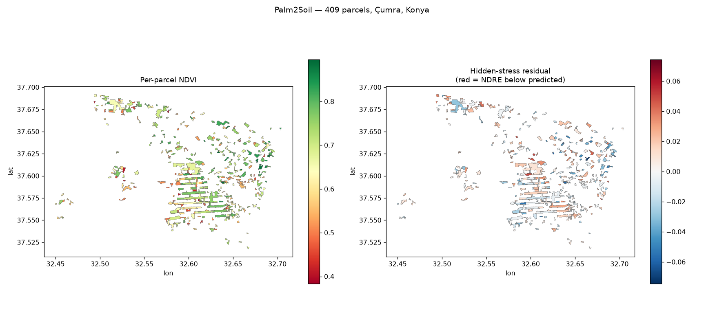
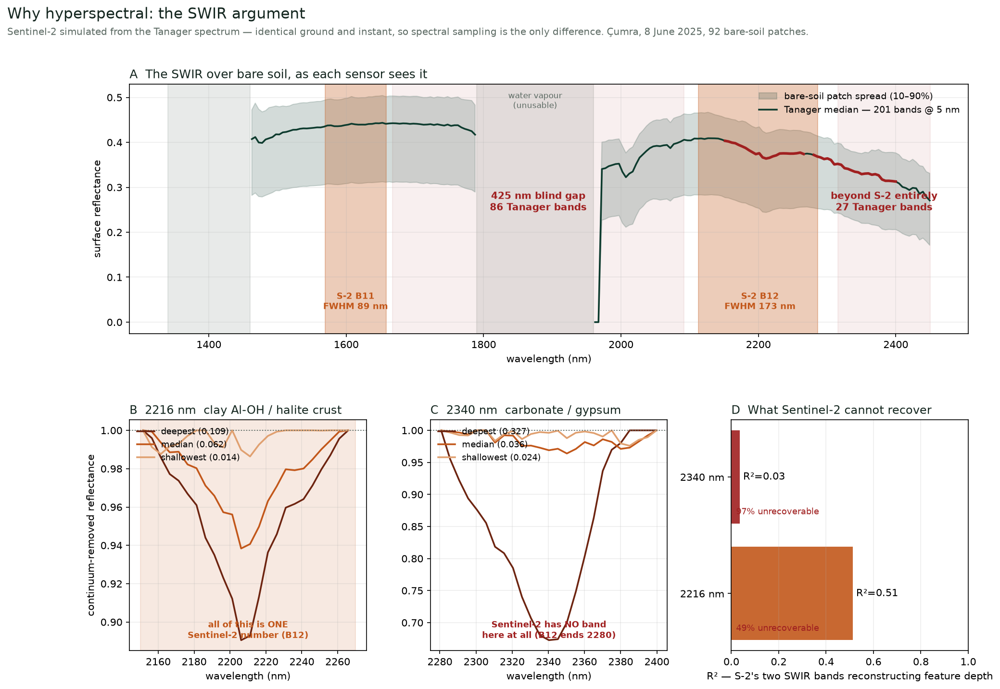

# Palm2Soil — satellite-guided salinity remediation using date palm waste

**Team Palm2Soil · Theme 2 — Precision Agriculture & Crop Intelligence · United Arab Emirates**
Arab Youth Space Hackathon 2026 · The 813 Challenge

> Palm2Soil turns a single hyperspectral acquisition into a **ranked
> inspection-priority list of farm parcels**, so an authority with a fixed
> soil-remediation budget has an evidence base for deciding which fields to
> check first.

Input is open satellite data. Output is one row per field parcel, ranked, with
data-quality figures and provenance attached to every row. It ranks parcels
relative to others in the same scene; it does **not** measure salinity in dS/m.

---

## 1. The business use case

**The user** is the authority allocating agricultural remediation budget across
thousands of farms — in the UAE context, a body such as the Environment
Agency – Abu Dhabi or the Abu Dhabi Agriculture and Food Safety Authority.

**The decision** is where to send a finite number of soil inspectors next
season, and which farms to treat first with a finite remediation budget.

**What they use today** is a 2009 ground survey and local knowledge. The survey
was based on roughly 50,000 soil samples and has not been repeated at
comparable scale in the seventeen years since, because ground sampling at that
density is not economically repeatable. In practice, allocation between farms
is guesswork.

**What Palm2Soil gives them** is a defensible order of inspection: every parcel
in a scene ranked, each row carrying the measurements behind its rank, the
quality of the imagery it was derived from, and the identifier of the run that
produced it — so a decision can be audited after the fact.

The full product design is a closed loop — **detect, prioritise, intervene,
verify** — in which each severity tier receives a matched intervention
(biochar and organic amendment from date palm pruning waste where stress is
moderate, drainage or leaching where it is severe, crop substitution where
recovery is not viable), and later scans measure whether treated farms recover
against untreated controls. **This proof of concept builds the first two
stages.** The last two are the incubation objective, and are described as
designed rather than demonstrated throughout this document.

---

## 2. The problem

Decades of groundwater irrigation have left large areas of UAE farmland with
soil salinity that reduces yield long before any damage is visible. Salinity
does not announce itself: by the time a farmer can see it, the soil has been
degrading for years.

**The scale.** The 2009 Environment Agency – Abu Dhabi assessment, based on
approximately 50,000 soil samples, found that about **90% of farms around
Al Ain were saline**, with **43% above 9.4 dS/m** and a further **26% between
6.25 and 9.4 dS/m** — the band where soil amendment is most likely to help.
Roughly two-thirds of farms irrigate with already-saline groundwater, so salt
continues to accumulate. Food security is a stated national priority, yet the
productive capacity of this farmland is being eroded by a process nobody is
currently measuring.

Separately, the UAE's date palms generate large volumes of pruning waste each
year, largely treated as a disposal problem. Peer-reviewed work, including
UAE-based trials, shows biochar produced from date palm waste improves water
retention, nutrient holding and microbial health in sandy, salt-affected soil.
Palm2Soil connects the two: the targeting layer decides where the amendment
goes.

**Why satellite data is the right instrument.** The problem is slow,
distributed and invisible — exactly the combination ground survey is too
expensive to track and orbital measurement is suited to. One acquisition
covers every farm in a region at field-parcel resolution, repeatably, at a cost
that does not scale with the number of farms.

**Why hyperspectral specifically.** Soil salinity is not directly visible to
any optical sensor — **pure halite has no diagnostic absorption in the
VNIR–SWIR.** It is inferred from hydration features and associated evaporite
minerals, whose absorptions are tens of nanometres wide and sit near 1450,
1850, 1950, 2200 and 2340 nm. Section 9 shows, measured rather than asserted,
that broadband sensors cannot resolve them.

---

## 3. Data used

| | Dataset | Details |
|---|---|---|
| **Primary** | Planet Tanager-1 hyperspectral | Scene `20250608_091605_90_4001`, Çumra, Konya, Türkiye, **8 June 2025**. 426 bands, 376–2499 nm, 30 m, HDF5. Processing level: **orthorectified surface reflectance (L2, `ortho_sr_hdf5`)**, with provider cloud, cirrus, no-data and per-band reflectance-uncertainty layers. Provider **Planet Labs**, via the open STAC catalogue. Licence **CC-BY-4.0**. |
| **Seasonal comparison** | Sentinel-2 MSI | Tile 36SVG, 25 dates thinned from 104 scenes under 20% cloud, March–October 2025. Processing level **L2A** (bottom-of-atmosphere), 10–20 m. Provider **ESA/Copernicus**, accessed via **Microsoft Planetary Computer**. Licence **CC-BY-4.0**. |
| **Sensor characterisation** | ESA Sentinel-2 Spectral Response Functions | **S2-SRF v5**, document COPE-GSEG-EOPG-TN-15-0007, unit S2A. ESA/Copernicus measured laboratory response curves, used to simulate Sentinel-2 from the Tanager spectrum. Bundled as `s2_srf_esa_v5.xlsx`. |
| **Reference figures** | 2009 soil salinity assessment | Abdelfattah et al., *Soil Survey Horizons*, Soil Science Society of America, 2009, commissioned by the Environment Agency – Abu Dhabi. Used for problem framing only; **not** used to validate any model output. |

Section 11 explains why the demonstration scene is in Türkiye rather than the
UAE, and what we did to establish that no alternative exists.

---

## 4. Technical approach

Workflow in execution order. Step numbers match the notebook's own headings.

| Step | What happens | Method and parameters |
|---|---|---|
| 1–3 | **Acquire** | STAC item read for the 426 band centre wavelengths; `ortho_sr_hdf5` asset fetched, or the bundled 128 × 128 px sample used when `DOWNLOAD_FULL = False` |
| 4 | **Mask** | `valid = (nodata == 0) & (cloud == 0) & (cirrus == 0)` using the provider's own layers. 68.7% valid, 2% cloud on this scene |
| 5 | **Band selection** | Nearest band to each target: blue 490, green 570, red 665, red edge 705, NIR 860, SWIR1 1650, SWIR2 2200 nm |
| 6 | **Indices** | **Canopy, on narrow bands:** NDVI (NIR, red), NDRE (NIR, red edge), NDMI (NIR, SWIR1), BSI (SWIR1, red, NIR, green). **Salinity, on broadband-equivalent reflectance** synthesised through the ESA S2A response curves: `SI_Khan` = √(G·R), `SI_Douaoui` = √(G²+R²+NIR²), `BI` = √(R²+NIR²), `CRSI`. Formulas verified against published sources — see `SALINITY_INDEX_VERIFICATION.md` |
| 7 | **Segment into parcels** | Watershed on the NDVI gradient. `NDVI_CROP_MIN = 0.35` defines actively cropped pixels; binary erosion drops mixed edge pixels; Sobel gradient on a 3 × 3 smoothed NDVI; seed markers from the flattest `GRAD_PCT = 50`% of field interior, `MIN_MARKER = 4` px; `ndimage.watershed_ift`. **Spatially disconnected pieces of a label are then split with 4-connectivity**, so one parcel is exactly one contiguous polygon. Parcels below `MIN_PIXELS = 20` (≈1.8 ha at 30 m) are dropped. Result: **409 parcels, 2,986 ha, median 4.0 ha** |
| 8 | **Per-parcel table** | Grid geometry **read from `StructMetadata.0` in the file, never hardcoded** — the sample is a crop with a different origin, and hardcoding the full scene's corner put every sample parcel 14.75 km from the truth. Mean and standard deviation of every index per parcel. Quality columns measure the parcel's **bounding box**, not its interior, because in-parcel validity is 1.0 by construction |
| 9 | **The score** | Scene-wide least-squares fit `NDRE = 0.899 × NDVI − 0.117`; each parcel scored by `stress_residual = NDRE_mean − NDRE_expected`, i.e. how far its chlorophyll signal falls **below the level its own greenness predicts**. More negative is more divergent. `confidence` is high/medium/low from pixel count, surrounding image quality and reflectance uncertainty; `needs_split` flags parcels above `BIG_PARCEL_HA = 50` |
| 10 | **Check it is signal** | Spatial autocorrelation of the score over a k-d tree of parcel centroids; decile comparison against NDMI, BSI and the salinity indices |
| 11 | **Priority map** | Per-parcel choropleth, diverging scale |
| 12 | **The hyperspectral argument** | Sentinel-2 simulated by integrating the Tanager spectrum through the ESA measured response curves — same ground, same instant, so spectral sampling is the only variable. Continuum removal (convex hull) on 92 bare-soil patches; absorption-feature depth at 2216 and 2340 nm regressed on the simulated Sentinel-2 bands |
| 13 | **Write deliverables** | `parcel_table.csv`, `parcels.geojson`, both stamped with a `run_id` |

No machine-learning model is trained. The ranking is a least-squares residual,
deliberately: with no ground truth to fit against, a fitted model would be
unfalsifiable. See section 10.

---

## 5. Installation

Requires **Python 3.12** (tested; 3.11 also works).

```bash
python -m venv .venv
source .venv/bin/activate          # Windows: .venv\Scripts\activate
pip install -r requirements.txt
```

**Platform note.** If `pip install` tries to build rasterio or pyproj from
source and fails asking for GDAL or PROJ, you are on Intel macOS 14. Recent
releases ship x86_64 wheels tagged `macosx_15_0`, which macOS 14 cannot
install. The pins in `requirements.txt` (`rasterio==1.4.3`, `pyproj==3.7.2`)
are the newest versions with a usable wheel. Apple Silicon and Linux are
unaffected.

---

## 6. How to run

```bash
jupyter notebook 07_palm2soil_salinity_prioritisation.ipynb
```

Run all cells. **Nothing needs editing** — the notebook runs out of the box on
the bundled sample, with **no network access and no downloads**. Runtime is
about **two minutes** on a standard laptop, no GPU required.

Reads `examples/input/sample_cumra_128px_ortho_sr.h5`, writes
`parcel_table.csv` and `parcels.geojson` to the working directory, and draws
the parcel maps inline. The final cell prints the run provenance block.

**One switch, if you want the full scene.** Set `DOWNLOAD_FULL = True` in
Step 3 and the notebook fetches the full 860 MB acquisition from Planet's open
archive. This is what produced everything in `examples/output/`; it takes
considerably longer and needs network access.

To see the results without running anything, open `examples/output/`, or open
`Palm2Soil_Dashboard.html` in a browser.

---

## 7. Example input and output

### Input

Two files in `examples/input/`.

**`sample_cumra_128px_ortho_sr.h5`** — a 128 × 128 pixel crop (3.8 × 3.8 km) of
the Tanager-1 acquisition, keeping the original HDF5 layout exactly. The
426-band axis is preserved so band indices still match the STAC wavelength
list, but bands the pipeline never reads are stored as zeros to keep the file
small. The crop was chosen to contain both actively cropped parcels and exposed
bare soil, because the pipeline needs both.

**`stac_item_20250608_091605_90_4001.json`** — the SpatioTemporal Asset Catalog
record. This is how the pipeline discovers the scene and reads the wavelength
of each of the 426 bands.

> **Sample numbers differ from the full-scene numbers.** The sample is stored at
> reduced precision and covers well under 1% of the scene area, so it yields
> far fewer parcels than 409 and the statistics differ. This is expected.

### Output



*`examples/output/parcel_check.png`, produced from the full scene. **Left:**
greenness. **Right:** the ranking quantity — how far each parcel's NDRE falls
below the level its own NDVI predicts; red is more divergent. The two maps do
not look alike, which is the point: the ranking is not re-describing greenness.
Scene extent 22.5 × 19.5 km, 30 m pixels.*

`parcel_table.csv` — one row per parcel:

| Column | Meaning |
|---|---|
| `parcel_id` | identifier, matches `parcels.geojson` |
| `run_id` | identifies which pipeline run produced these ids |
| `area_ha`, `n_pixels` | size |
| `lon`, `lat` | centroid, WGS84 |
| `NDVI_mean` / `_std` | greenness |
| `NDRE_mean` / `_std` | chlorophyll, red edge |
| `NDMI_mean` / `_std` | canopy water |
| `BSI_mean` / `_std` | bare soil |
| `SI_Khan`, `SI_Douaoui`, `BI`, `CRSI` | published salinity indices |
| `stress_residual` | **the ranking quantity** |
| `stress_rank` | 1 = most divergent |
| `local_valid_frac`, `local_cloud_frac` | clear / cloudy share of the area around the parcel |
| `refl_uncertainty` | provider's own reflectance uncertainty |
| `confidence` | high / medium / low |
| `needs_split` | true if probably several merged fields |

For analysis, filter to `confidence != 'low'` and `needs_split == False` —
**345 of 409 parcels**.

Also written: `parcels.geojson` (same rows, with polygons, WGS84), and the two
self-contained HTML applications, `Palm2Soil_Dashboard.html` (authority view)
and `Palm2Soil_FieldApp.html` (field capture). Neither needs a server or an
internet connection.

---

## 8. Results

**409 parcels** segmented from one acquisition, 2,986 ha, median 4.0 ha.
**345 usable** after excluding low confidence and merged parcels. 180 high
confidence, 170 medium, 59 low; 5 flagged `needs_split`.

Scene-wide fit `NDRE = 0.899 × NDVI − 0.117`; residual spread sd 0.0233, range
−0.0744 to +0.0539.

**Two checks that the ranking measures something real**, both computed in the
notebook:

1. **Spatially coherent.** Neighbouring parcels have correlated scores
   (**r = +0.23**). Noise would be spatially random.
2. **Physically consistent.** The most-divergent decile is drier
   (NDMI −0.045), barer (BSI +0.036) and more saline-looking (+0.016) than the
   least divergent — while being only marginally less green (NDVI −0.018).
   **Standard greenness separates the two groups least of all**, which is the
   case for not simply ranking on NDVI.

### Why hyperspectral — measured, not asserted



*`examples/output/swir_absorption_argument.png`. Sentinel-2 simulated from the
Tanager spectrum through ESA's measured response functions — identical ground
and instant, so spectral sampling is the only difference. 92 bare-soil patches.*

| 1500–2500 nm | Tanager-1 | Sentinel-2 |
|---|---|---|
| Bands in range | **201** | 2 |
| 1931–2123 nm salt window | 39 | 6.2% of its SWIR response |
| 1667–2092 nm | 86 | **zero — a 425 nm blind gap** |
| 2316–2450 nm | 27 | **zero — B12's response has ended** |

Measured on bare soil, Sentinel-2's two SWIR bands reconstruct only **51%** of
the variance in the 2216 nm feature depth (clay Al-OH / halite crust) and **3%**
of the 2340 nm feature (carbonate / gypsum). Band counts are sensor design and
hold regardless of scene.

Detection and crop monitoring need **different pixels**: salt crusts are a
soil-surface phenomenon, so these features are measured on bare ground. Over a
closed canopy the SWIR carries leaf water, not soil chemistry. That follows
from the physics, and the product design reflects it.

### Closing the loop

The field app exports its records as JSON; `import_observations.py` reads them
back, validates each one against the parcel table, and writes
`observations_joined.csv` — one row per observation with that parcel's
satellite measurements attached.

```bash
python import_observations.py examples/input/sample_field_records.json \
       --data-dir examples/output
```

Records that cannot be matched are **never discarded quietly**. An unknown
parcel id, a record from a different scene or run, a malformed timestamp, a
malformed field id or a missing field are each reported individually and
written to `observations_unmatched.csv`, and the command exits non-zero. An
unmatched record almost always means a real mistake — a stale export, or a
table regenerated since the observation was made — and silence would hide it.
The second example file exercises every case:

```bash
python import_observations.py examples/input/sample_field_records_with_errors.json \
       --data-dir examples/output
```

**This joins; it does not calibrate.** Producing a dS/m model needs laboratory
soil values and far more records than a prototype collects. The joined table is
the input that work would start from — precisely the gap named below.

### How this was validated

- **33 end-to-end smoke checks** (`smoke_test.py`): executes the notebook on
  the bundled sample, confirms ids agree between table and GeoJSON, verifies
  every geometry is topologically valid, verifies every coordinate falls inside
  the sample footprint, rebuilds both applications from those outputs, and
  confirms every field they feature exists in the dataset.
- **31 unit tests** (`python -m unittest discover -s tests`) over the pipeline,
  the applications, dataset selection and run identity.
- Every published number traces to a script in `src/`.

What we did **not** do is validate against ground truth, because none exists
for this scene. See below.

---

## 9. Limitations

Stated plainly, because a proof of concept that overstates its reach is worth
less than one that knows its boundaries.

**No absolute salinity.** All ranking is **relative within a scene**. Converting
to dS/m needs paired ground measurements at known locations; the 2009 EAD
assessment is available to us only as regional percentages, and a per-pixel map
cannot be validated against a summary statistic. Obtaining georeferenced ground
truth is the first objective of the incubation phase. Until then, intervention
tiering is a designed mechanism, not a calibrated one.

**No seasonal prediction.** We tested whether the single-date score predicts
seasonal performance across 25 Sentinel-2 dates. **It does not** (|r| ≤ 0.25,
signs opposite to a stress interpretation). On one acquisition,
canopy–chlorophyll divergence cannot be cleanly separated from crop type and
growth stage. The score indicates **where to inspect**, not what will happen.

**Parcels are not cadastral.** They are segmented from the imagery by watershed
on the NDVI gradient, approximating management units. Spatially disconnected
regions are split, so one parcel is exactly one contiguous polygon. 5 of 409
are flagged `needs_split`.

**Single acquisition.** Tanager imaged this footprint **once** in the entire
open archive — a real operational constraint of the sensor. Seasonal tracking
is demonstrated with Sentinel-2 instead.

**No treatment effect.** No treatment occurred in this scene, so recovery of
treated against untreated blocks remains designed rather than shown.

**Salinity indices are not calibrated.** The four published indices are
verified as formulas and computed on broadband-equivalent reflectance, but none
is tied to a measured dS/m value. They are descriptive context; the ranking
does not depend on them.

### Two results that went against us

Both are kept in the submission, and both are reproducible from the notebook.

**The red-edge justification did not hold.** Our application argued
hyperspectral on red-edge position shifts. Sentinel-2 reconstructs red-edge
position at R² 0.68, and its NDRE separated an independent grouping better than
either red-edge metric. The hyperspectral case was rebuilt on SWIR absorption,
where the evidence is far stronger.

**The score does not predict the season.** As above.

Each led to a better-specified design — the complementary-sensor architecture
and the SWIR argument respectively. A justification that survives its own test
is worth more than one never tested.

---

## 10. Team, licence and attribution

### Team

| Member | Role | Responsible for |
|---|---|---|
| **Syeda Amsha Nasar** | EO Data & Pipeline Lead | Scene selection and the 276-scene archive audit, STAC ingestion, cloud and no-data masking, watershed parcel segmentation — `src/make_parcel_table.py`, notebook Steps 1–8 |
| **Zahny Fatima** | Spectral Analysis Lead | Vegetation and salinity indices, the NDRE~NDVI divergence score, ESA SRF sensor simulation, continuum removal and the SWIR argument — `s2_srf.py`, `src/make_swir_figure.py`, notebook Steps 9–12 |
| **Huda Ibrahim** | Validation & Reproducibility Lead | Spatial-coherence and decile checks, the two negative results, run-identity fingerprinting, 33 smoke checks and 31 unit tests — `smoke_test.py`, `run_identity.py`, `tests/` |
| **Hanan Ibrahim** | Product & Interfaces Lead | Authority dashboard, field capture app, and the observation importer that closes the loop — `src/make_dashboard.py`, `src/make_farmer_app.py`, `import_observations.py` |
| **Marwa Khot** | Domain Research & Submission Lead | Salinity and biochar literature, the 2009 EAD figures, the Konya analogue justification, use-case document, README and presentation |

### Licence

Our code and documentation in this package are released under the **MIT
Licence**. Data licences are those of the providers, listed in section 3.

### Attribution

| Component | Credit |
|---|---|
| Hyperspectral imagery | **Planet Labs**, Tanager-1 open data programme, CC-BY-4.0 |
| Seasonal imagery | **ESA/Copernicus** Sentinel-2, via **Microsoft Planetary Computer**, CC-BY-4.0 |
| Spectral response functions | **ESA/Copernicus**, S2-SRF v5, COPE-GSEG-EOPG-TN-15-0007 |
| Salinity index formulas | Khan et al.; Douaoui et al. (2006); Scudiero et al. (CRSI) — verified in `SALINITY_INDEX_VERIFICATION.md` |
| 2009 salinity figures | Abdelfattah et al., *Soil Survey Horizons*, Soil Science Society of America, 2009, commissioned by the Environment Agency – Abu Dhabi |
| Notebook scaffolding | The 813 Challenge starter notebooks (`00_EO_data_quickstart`, `01_agriculture_crop_intelligence`), from which the index conventions were taken for comparability |
| Libraries | numpy, scipy, pandas, rasterio, pyproj, shapely, h5py, matplotlib, pystac-client, planetary-computer |

---

## 11. Why the demonstration is in Türkiye, not the UAE

**There is no usable UAE hyperspectral scene in the open Tanager archive.** We
established that by auditing all 276 scenes across all nine collections rather
than assuming it. Three fall in MENA, all above 50% cloud; the agriculture
collection contains none on the Arabian Peninsula; the single UAE scene is in
an unrelated collection at 51% cloud and 25.8° off-nadir, over Al Dhafrah
rather than Al Ain.

We therefore demonstrate on the **Konya–Çumra Plain**, a documented
secondary-salinisation case and a close structural analogue to Al Ain: a
semi-arid endorheic basin where roughly 90% of irrigation water is drawn from
groundwater, with about 1 m per year of water-table decline and published
water–salt balance studies.

Reported root-zone salinity there is milder than the UAE bands, so this is
framed as detecting the condition *before* it reaches UAE severity. The
sampling argument transfers unchanged because it concerns instrument design;
the specific mineral features present will differ with local soil chemistry.

---

## Appendix A — package contents

```
README.md                                 this file
LICENSE                                   MIT, for the team's own code
requirements.txt                          pinned dependencies
SALINITY_INDEX_VERIFICATION.md            the four index formulas, checked against sources
FIXES_AND_TESTS.md                        defects found during review and what guards them now
smoke_test.py                             end-to-end regression check
dataset.py                                dataset selection and id validation
run_identity.py                           shared geometry-based run fingerprint
import_observations.py                    joins field records back to measurements
tests/                                    dataset, importer, app and pipeline regressions
07_palm2soil_salinity_prioritisation.ipynb    the pipeline, end to end
s2_srf.py                                 ESA Sentinel-2 response loader
s2_srf_esa_v5.xlsx                        ESA S2-SRF v5 (COPE-GSEG-EOPG-TN-15-0007)

examples/input/
  sample_cumra_128px_ortho_sr.h5          6.8 MB — 128×128 px crop, runs offline
  stac_item_20250608_091605_90_4001.json  scene metadata and band wavelengths
  sample_field_records.json               8 ground observations from the field app
  sample_field_records_with_errors.json   deliberately broken records, for the importer

examples/output/                          produced from the FULL scene
  parcel_table.csv                        409 parcels × 30 columns
  parcels.geojson                         same, with polygons (WGS84)
  parcel_summary.txt                      text digest
  parcel_check.png                        parcel maps
  swir_absorption_argument.png            why hyperspectral is necessary
  swir_stats.txt                          the numbers behind it
  rededge_sentinel2_vs_tanager.png        a test that went against us
  rededge_stats.txt
  temporal_trajectories.png               25 Sentinel-2 dates, same parcels
  temporal_stats.txt
  sample_run_executed.ipynb               the notebook run on the bundled sample

Palm2Soil_Dashboard.html                  authority dashboard (open in a browser)
Palm2Soil_FieldApp.html                   field capture app (mobile view)
```

---

## Appendix B — a note on data quality columns

Parcels are **built from valid pixels**, so validity measured *inside* a parcel
is 1.0 for every parcel by construction. An earlier version reported exactly
that and it was meaningless. The columns now measure the parcel's
**surrounding area** instead — `local_valid_frac` and `local_cloud_frac` cover
its bounding box, which includes the masked pixels around it and therefore
actually varies (0.71–1.00 on the full scene).

`confidence` combines the three things that genuinely differ between parcels:
how many pixels it averages over, how clean the imagery around it is, and the
provider's own reflectance uncertainty. It is **not** a claim about in-parcel
validity.

Every output also carries a `run_id`. Parcel ids are only unique within one
run — a sample run numbers 1..20 and so does the start of a full-scene run —
so anything referring to a parcel must also say which run it meant. The
importer rejects records whose run id is absent or does not match.

Run fingerprints use the parcel geometries, coordinate reference systems and
segmentation settings through one shared function. The notebook and standalone
pipeline use the same rule, independent of table row order or rounded display
measurements. The importer checks scene identity from the run identifier even
when no `parcel_summary.txt` is present.

If no parcels pass the quality filter, both apps show that ranking is
unavailable. They do not assign priorities to excluded parcels.

---

## Appendix C — reproducing everything

**The notebook is the thing to run** — it works out of the box on the bundled
sample. Everything in `src/` is included so every published number is
traceable, but the scripts have different requirements.

**Run in this package as shipped:**

```bash
python smoke_test.py                      # runs the notebook, then checks everything
python -m unittest discover -s tests -v   # edge-case regression tests
python src/make_dashboard.py              # rebuilds the authority dashboard
python src/make_farmer_app.py             # rebuilds the field app
python import_observations.py examples/input/sample_field_records.json \
       --data-dir examples/output         # joins field records to measurements
```

Both app builders take `--data-dir` to say which dataset to use, and `-o` for
the output path. With neither, they look in the package root first, then
`examples/output/`, and print which one they chose. The dashboard reads its
table and GeoJSON from the **same** directory and requires matching parcel and
run identities. Both builders reject duplicate parcel ids and missing or
inconsistent run metadata. This prevents measurements from being attached to
shapes from a different run.

**Needs the full 860 MB scene** (set `DOWNLOAD_FULL = True` in the notebook, or
fetch `ortho_sr_hdf5` from the STAC item in `examples/input/`, and place it at
the package root):

```bash
python src/make_parcel_table.py    # parcel table + geojson
python src/make_swir_figure.py     # the hyperspectral argument
python src/make_rededge_figure.py  # the test that went against us
python src/make_example_input.py   # regenerates the bundled sample
```

**Needs the full scene and network access:**

```bash
python src/make_temporal_figure.py  # 25 Sentinel-2 dates via Planetary Computer
```

The notebook itself is generated by `src/build_palm2soil_notebook.py`, so its
content stays reviewable as source rather than hand-edited JSON.
